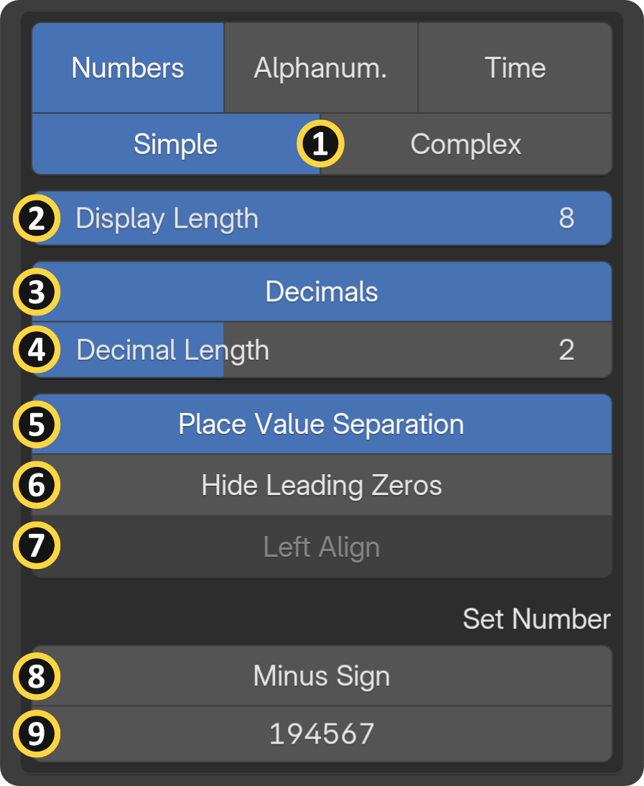
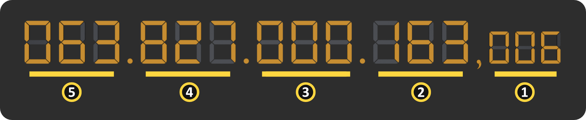
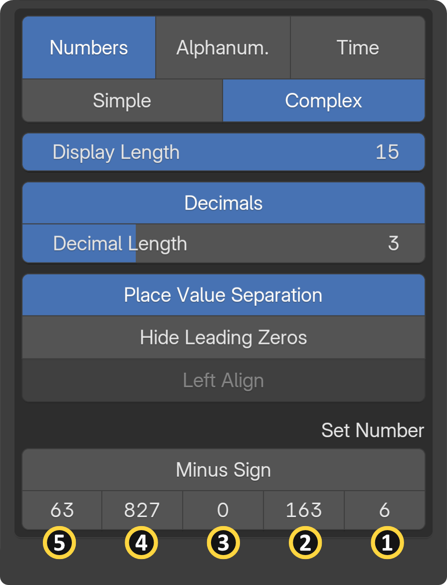

## Simple Number Inputs

{ align=right width="400" }

**[1] Number Input Option:**

- **Simple:** Up to 8 display digits with a single input. The maximum input value is **10,000,000**; an 8-digit display does not mean every 8-digit value is supported. See [Troubleshooting: Numbers](troubleshooting.md#numbers) for details.

- **Complex:** Up to 15 display digits using five input groups.

**[2] Display Length:** The Digit Count.

**[3] Decimals** allows you to enable or disable decimal values within your digital readouts. Depending on the input category you are using, it serves a few specific purposes:

- **In the Numbers Category:** Enabling this option allows you to set an exact "Decimal Count," giving you precise control over the decimal precision of your readout.

- **In the Time Category (Timers):** Toggling timer decimals allows for high-precision time tracking. Once enabled, you can set the display to show specific decimal time units, such as centiseconds, deciseconds, or milliseconds.Read more on the [Time page](in_cat_time.md#timer).

**[4] Decimal Length:** This option becomes available when **Decimals** is enabled. It allows you to specify the number of decimal places to display in your digital readout, providing fine-tuned control over the precision of your numerical data.

!!! warning "**Decimal Length** cannot equal the main **Display Length [2]**. An error message will appear if they match."

**[5] Place value separation** is the system that determines how much each digit in a number is worth based on its position, which is calculated in powers of ten (ones, tens, hundreds, thousands, and so on).

**[6] Hide Leading Zeros:** A leading zero is a "0" digit preceding the first non-zero digit in a number string. These zeros do not affect the mathematical value of whole numbers, so they can be omitted or hidden without losing information. However, leading zeros are necessary to convey magnitude for numbers after a decimal point and cannot be removed. The "Hide Leading Zeros" toggle in the Segment Display Add-on formats digital readouts by hiding non-value zeros next to numbers.

**[7] Left Align:** The current number is snapped to the left side of the display. This feature is only available if "decimals" or "place value separation" is disabled.

**[8] Minus Sign:** Procedurally toggles the minus sign to produce negative numbers.

**[9]** The current value displayed on the readout.

## Complex Number Input

Blender uses single-precision floats (float32), which limit the precision of a single number input. SegDisp Pro's Simple input supports values up to **10,000,000**. For larger values, use **Complex** input to build a number from five three-digit input groups, each accepting **0-999**, for up to **15 display digits**.

The groups control blocks of the current number; they are not fixed decimal or place-value separator groups. **Display Length** determines which groups remain active, while **Decimals** and **Decimal Length** determine decimal formatting. The rightmost group **[1]** remains active for whole numbers when Decimals is off.

<figure markdown>
  { width="600" }
</figure>

<figure markdown>
  { width="400" }
</figure>

The callouts below refer to the five input fields in the Complex Number UI screenshot, numbered from right to left:

**[1] Rightmost input group:** Sets the rightmost three-digit block of the current number, from 0-999; it is not reserved for decimals.

**[2] Second input group:** Sets the next three-digit block to the left of [1], from 0-999.

**[3] Third input group:** Sets the next three-digit block to the left of [2], from 0-999.

**[4] Fourth input group:** Sets the next three-digit block to the left of [3], from 0-999.

**[5] Leftmost input group:** Sets the leftmost three-digit block, from 0-999.

**Note:** Groups that are not needed for the selected Display Length become inactive. These five callout numbers are separate from the Simple Number Inputs callouts above.
