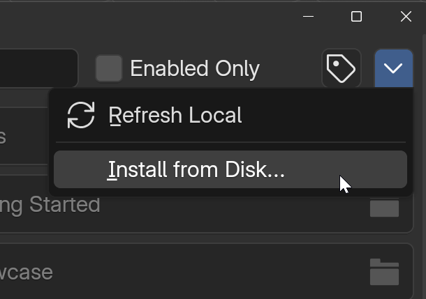
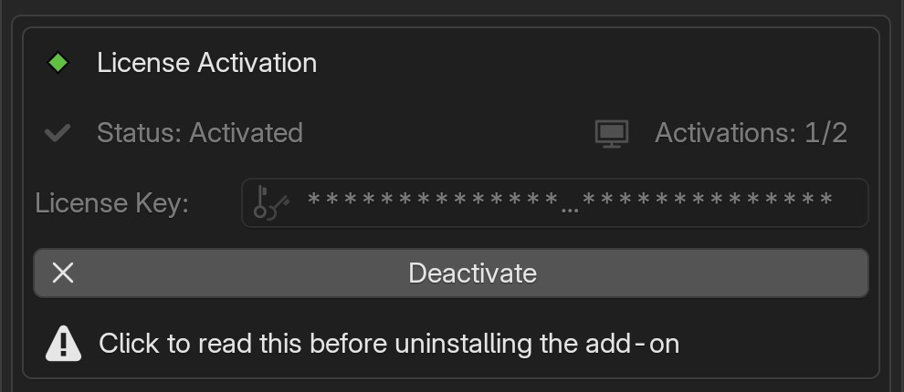

# Installation & Activation

!!! info
    Both editions of Segment Display are distributed as zip-formatted Blender legacy add-ons, not extensions. Install them from the "Add-ons" tab in the Preferences window using the "Install from Disk" option in the top-right dropdown menu.

## Requirements

Before you begin, make sure your system matches the add-on's requirements:

| Item                | Requirement         |
| ------------------- | ------------------- |
| Compatible Blender  | 5.1.1                  |
| Render Engines      | Eevee, Cycles          |
| OS Platforms        | Windows, Linux, macOS  |
| Add-on Format       | Legacy/zip             |
| Script Size         | 492 – 575 KB           |
| Asset Size          | 170 – 200 MB           |
| Internet Connection | To activate/deactivate, and at least once every 14 days ([see below](#activationdeactivation)) |

!!! info "OS Compatibility"
    The Segment Display add-on was not developed for a specific operating system. However, it has only been tested on a Windows 11 system. Before purchasing the Pro edition, we recommend testing your system with the free Lite edition.

## Downloading the Add-on

Download the Segment Display Pro zip file from your purchase/download location.
You will also receive a license key, which is required to unlock the product.

## Installation

The add-on ships with the asset blend file already included in the zip package. It will be installed automatically into the Blender addons directory when you complete the installation steps below.

!!! warning "Do not unpack the "segment_display_pro_vX.X.X.zip" file"
    Install the add-on directly from the zip file. Do not extract or rename the
    files inside it, as this can break the add-on.

{ align=right width="350" }

1. Open Blender.
2. Go to **Edit** → **Preferences** → **Add-ons**.
3. Click the down arrow at the top right and choose **"Install from Disk..."**.
4. In the file browser, open the settings panel (gear icon, top right). Under **"Legacy Add-ons"**, make sure **"Target Path"** is set to **"Default"** and **"Overwrite"** is ticked.
5. Select the **Segment Display Pro ZIP file**, then click **"Install from Disk"**.
6. Make sure **"Segment Display Pro"** is enabled (checkbox ticked).

After enabling, the add-on appears in the 3D Viewport sidebar under the
**SegDisp Pro** tab.

!!! warning "Only Blender's default add-on folder is tested"
    Installing into a custom add-on directory (a custom Target Path or custom Script Directory) may cause problems with using, activating and updating the add-on.

## Add-on Default File Directory

The add-on and its related asset files will be installed in the same directory (Blender Foundation scripts\addons).

- WINDOWS:
      - Add-on Script Files: `C:\Users\$USER\AppData\Roaming\Blender Foundation\Blender\5.1\scripts\addons`
      - Add-on Asset Files: `C:\Users\$USER\AppData\Roaming\Blender Foundation\Blender\5.1\scripts\addons\segment-display-pro\assets`
- MacOS: `/Users/$USER/Library/Application Support/Blender/5.1/scripts/addons/`
- Linux: `~/.config/blender/5.1/scripts/addons/`

!!! warning "Custom Add-on Directory"
    If you use a custom add-on directory, proper linking of asset files within a scene cannot be guaranteed, even when the add-on uses relative paths to reference assets. This add-on has only been tested with the default Blender scripts directory.

## Activation/Deactivation

{ align=right width="500" }

After purchasing Segment Display Pro, you will receive an order confirmation email from Lemon Squeezy containing your license key. You can also find your license key anytime in your Lemon Squeezy account under your order details.

1. In **Edit** → **Preferences** → **Add-ons**, expand **"Segment Display Pro"**.
2. Paste your license key into the **"License Key"** field. **(Mouse Right-click to paste does not work — use Ctrl+V instead.)**
3. Click **"Activate"**.
4. When it shows as activated, you're done. Activation stays active after you restart Blender, update or reinstall the add-on, or move to a newer Blender version.

The status monitor above the key field displays your current activation status (top-left) and your activation limit/seats (top-right).

!!! internet "Internet Connection Required"
    License activation and deactivation both require an internet connection. Activation validates your license key online, and deactivation contacts the server to free up your activation slot. This ensures your activation count stays accurate and protected. If either fails, make sure "Allow Online Access" is enabled in Blender under Preferences > System > Network.

!!! info "Working offline (14-day grace period)"
    Once activated, the add-on re-checks your license with the Lemon Squeezy server when Blender starts. If the server can't be reached (no internet connection, or "Allow Online Access" is turned off), the add-on keeps working for up to **14 days** after its last successful check. Every successful check resets the 14-day period.

    In the last 3 days, a red warning with the days left (for example **"Offline verification: 2 days left"**) appears at the top of the add-on's N-panel and in the license panel in Preferences. After 14 days without a successful check, the add-on locks and the warning changes to **"Offline period expired"**. Under each warning, **"Read more..."** explains what happened and what to do, and **"Verify now"** checks your license online right away. If you're still offline, Verify now tells you that an internet connection is required.

    To unlock it, connect to the internet, make sure "Allow Online Access" is enabled, and click **"Verify now"**. The add-on also checks again on its own within about 2 minutes, or when you restart Blender. Your license is confirmed again and the 14-day period starts over. This does not use a new activation seat.

    Setting your computer's clock back also locks the add-on (**"System clock was moved back"**). Set the correct date and time, go online, then click **"Verify now"**.

    If you usually work offline, go online and open Blender at least once every 14 days to keep the add-on unlocked.

### The License File

Your activation is saved in a small license file (**sdp_activation.lic**) outside the add-on folder, so updating or reinstalling the add-on doesn't affect it:

- Windows: `%LOCALAPPDATA%\OrionNovember.Studio\SegmentDisplay_Pro\`
- macOS: `~/Library/Application Support/OrionNovember.Studio/SegmentDisplay_Pro/`
- Linux: `~/.local/state/OrionNovember.Studio/SegmentDisplay_Pro/` (or `$XDG_STATE_HOME/OrionNovember.Studio/SegmentDisplay_Pro/` if set)

!!! warning "Do not edit, move or copy the license file"
    Don't edit or move this file, and don't copy it to another computer. The license file is tied to the computer it was activated on, so a copied file will not unlock the add-on on any other machine. Every new or additional computer must be activated on its own by entering your license key in the add-on preferences, and each activation uses one seat of your activation limit. Deleting the file does **NOT** free up an activation slot. Use "Deactivate" in the add-on or your Lemon Squeezy order dashboard instead.

### Activation Limit

Your Segment Display Pro license key includes 3 activations (seats), and every new device counts toward that limit.

!!! warning "Moving to a new computer?"
    **Deactivate** the license on the old machine first. Uninstalling the add-on without deactivating does **NOT** free up the activation slot. Lost access to the old machine? You can deactivate it yourself from your <a href="https://app.lemonsqueezy.com/my-orders" target="_blank" rel="noopener">Lemon Squeezy order dashboard</a>, where you can also see and manage all your activations.

!!! info "Reinstalling your operating system?"
    Reinstalling your operating system counts as a new computer. The add-on will ask you to activate again, and the old activation keeps its slot until you remove it from your <a href="https://app.lemonsqueezy.com/my-orders" target="_blank" rel="noopener">Lemon Squeezy order dashboard</a>.

!!! privacy "Privacy Notice"
    During license activation, your custom device name (e.g., SDPRO-QUEEN-WINDOWS11) is stored on our online system dashboard. This information is used exclusively by our customer support to assist you in the event of any activation issues. By activating your license, you consent to sharing this device identifier with us.

!!! info "Device name on the dashboard"
    The device name on your Lemon Squeezy order dashboard is your computer's name at the time you first activated. Renaming the computer later doesn't change it there, and doesn't use a new activation. Want the new name to show? Click "Deactivate", then "Activate" again. This frees the old slot and takes a new one, so your activation count stays the same.

## Updating the Add-on

1. No need to remove the old version. Install the new ZIP right over it (see [Installation](#installation) above) with **"Target Path"** set to **"Default"** and **"Overwrite"** ticked, then restart Blender.
2. Your license stays activated, no need to reactivate. The license file is stored outside the add-on folder (see [Activation/Deactivation](#activationdeactivation) above), so updates don't touch it.
3. Open your project. Your Segment Display objects are restored with the updated asset, and your current add-on panel settings are kept.
4. Objects didn't come back after restarting Blender? Go to **Edit** → **Preferences** → **Add-ons**, expand **"Segment Display Pro"**, and click **"Re-link Asset"** in the **"Asset Status"** section.

!!! info "Re-link Asset only works within the same Blender version"
    If the new version of the add-on requires a newer version of Blender, you will be notified. Blender keeps add-ons in a separate folder for each version, so the asset file path changes when you switch Blender versions.

!!! warning "Custom add-on directories are not tested"
    If you installed the add-on into a custom Target Path or Script Directory, updating may not work properly. Use the default add-on folder.

## Uninstalling

!!! warning "Always deactivate your license before uninstalling the add-on"
    If you remove the add-on without deactivating first, the device will still count toward your activation limit. Unfortunately, Blender does not allow add-ons to prevent or intercept the uninstall action. If you accidentally uninstall without deactivating, you can manage your activation seats yourself by logging into the <a href="https://app.lemonsqueezy.com/my-orders" target="_blank" rel="noopener">Lemon Squeezy customer portal</a> with your purchase email. Under your order's license key details, you can view all active devices and deactivate any instance to free up a seat. If you need help with this, please reach out to our support email for guidance.

!!! info "Accidentally Uninstalled the Add-on Mid-Project?"
    If you accidentally uninstall the add-on, all your segment display objects will appear as planes on the next Blender launch, because the linked asset file is no longer available. The link directory information, however, is retained in the Blender file as a broken link. To restore everything, simply re-install the add-on and click the Re-link button in the Preferences > "Asset Status" panel — all your objects will be restored with their original settings.

