The Settings & Preferences panel is where you manage your license activation and monitor the health of your linked asset files. Access it via Edit > Preferences > Add-ons, then expand the Segment Display Pro entry.

## License Activation

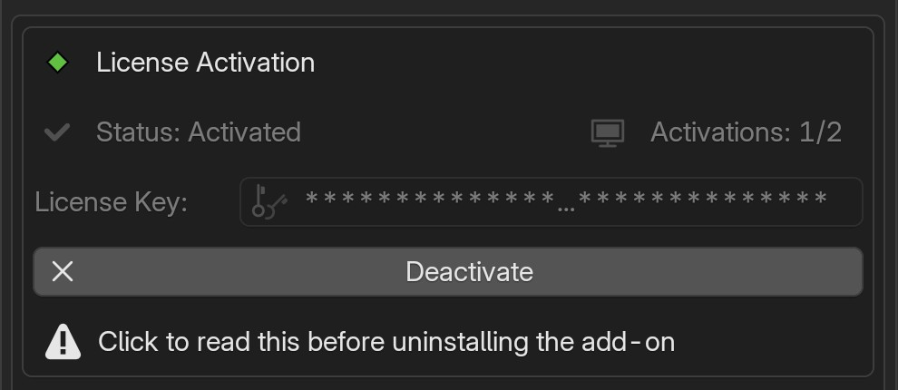{ align=right width="550" }

The License Activation section displays your current activation status and allows you to manage your license key.

License notice: In the last 3 days of the offline grace period (e.g. "Offline verification: 2 days left") or when the add-on is locked (e.g. "Offline period expired"), a red message appears at the top of this section. The same notice also appears at the top of the add-on's N-panel. See the [Activation page](installation.md#activationdeactivation) for details.
Read more...: Opens a popup with the full explanation and the steps to fix it.
Verify now: Checks your license online right away and shows the result: "License Verified", "No Internet Connection" or "Verification Failed". Verifying never uses another activation seat. See [Verify now results](troubleshooting.md#verify-now-results).

Status: Shows whether your license is currently activated or not (checkmark icon when active). When the add-on is locked, it shows "Not Activated" and the reason appears in the red license notice above it. Other problems, for example "Activation belongs to another computer", are shown here.
Activations: Displays how many device slots you've used out of your total allowance. **Pro: 3 activation seats; Lite: 1 activation seat** (e.g. 1/3 for Pro or 1/1 for Lite). The count is refreshed by the online check, so it shows "(last known)" when the add-on is locked or the offline grace period is almost over.

License Key: The masked key field where you enter or view your license key.
Activate: Activates your license key on this device. If this device was activated before, its existing seat is reused instead of taking a new one.
Deactivate: Removes the license activation from the current device, freeing up a slot for use on another machine.

!!! warning
     Always deactivate your license before uninstalling the add-on. If you skip this step, the device will still count toward your activation limit. See the [Activation page](installation.md#activationdeactivation) for more details.

## Asset Status Panel

### Review & Recover

:material-tag-outline: **Pro v1.0.1 and later**

Your displays use a linked asset file supplied with the add-on. **Review & Recover…** checks supported connections and lets you review repairs before applying them. Open **Edit > Preferences > Add-ons > Segment Display Pro > Asset Status**.

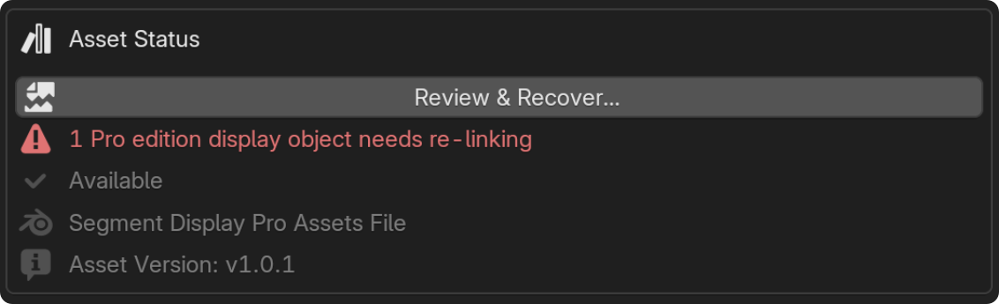{ align=right width="550" }

**Available** means the installed asset file can be found, not that every display in your project is connected correctly. A separate message can report displays needing re-linking or toggle inputs needing repair. The asset name and **Asset Version** identify the installed asset.

**Lite users:** Lite uses a different, simplified Re-link operation. Its recovery procedure is not covered in this Pro manual. Pro recovery does not convert Lite objects into Pro objects.

#### Before you recover

Save a copy of your project. If displays appear as planes after an update or reinstall, **restart Blender and reopen the project first**. Reinstalling the complete matching add-on and restarting usually restored displays automatically in testing. If the displays, settings and animation are correct, no manual recovery is needed.

If Asset Status reports **Not Available**, follow [the missing-asset steps](#asset-not-available) before attempting recovery. Do not delete modifiers, remove node-tree assignments or edit recognition properties to repair a missing asset connection.

#### Restore Node Tree

This section restores the asset-tree assignment on an existing, identified modifier. Review the listed object, scene and modifier before leaving it selected.

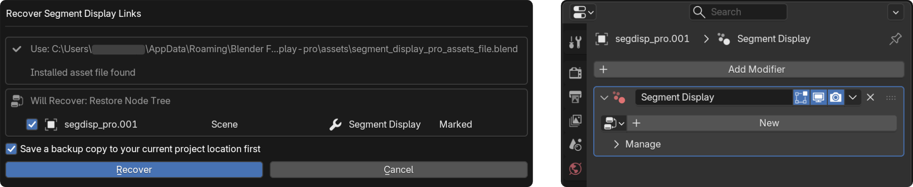

!!! warning "Deleted settings and animation are not restored"
    Assigning the tree again cannot restore input settings or animation already deleted when you removed the node tree from the Geometry Nodes panel. By contrast, removing the asset through **Outliner > Blender File** can leave settings that recovery can retain. Recovery depends on the data still present; do not deliberately delete the asset as a repair step.

    **In v1.0.1**, Restore Node Tree does not display the deleted-settings warning in the dialog. Its absence is not a promise that deleted data can be recovered.

#### Recreate Missing Modifier (Defaults)

If a recognized, supported Pro object has no Geometry Nodes modifier, recovery can offer to create one. **This option is unchecked by default.** Select it only when you want a replacement using defaults.

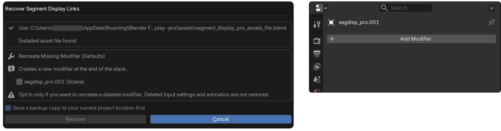

The new modifier is added at the end of the stack. **Deleted input settings, animation and the original modifier-stack position are not restored.** Not every object with a missing modifier qualifies for recreation.

#### Needs Review

These entries are unchecked by default because recovery cannot confidently choose the target. Select only a display you recognize, then choose its correct empty Geometry Nodes modifier from the dropdown.

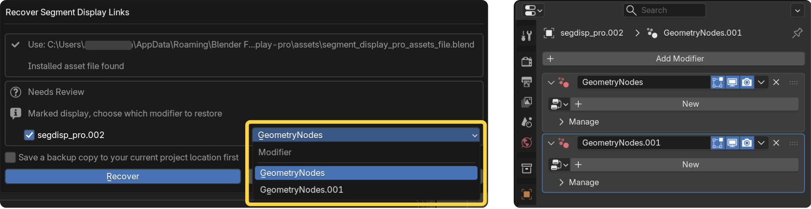

*segdisp_pro.002 selected here after review.*

The object's `segdisp_*` properties can identify it as a Pro display without identifying which empty modifier belongs to it. Recovery also checks the remembered modifier name in `segdisp_modifier`. If that name no longer matches, or the target is ambiguous, a generic name such as **GeometryNodes** or **GeometryNodes.001** is not enough to choose safely. A generic name does not always require review: an exact remembered match can still identify the correct modifier.

**Do not rename or delete the SegDisp modifier or change its recognition properties manually.** If you cannot identify the correct modifier, leave the entry unchecked. A name-based candidate is not proof that an object belongs to SegDisp.

#### Reconnect Asset Library

Use this section when a supported project library link is broken or points to an asset outside the current installation. Check the stored path, installed target and affected displays, then review **Reconnect this library**.

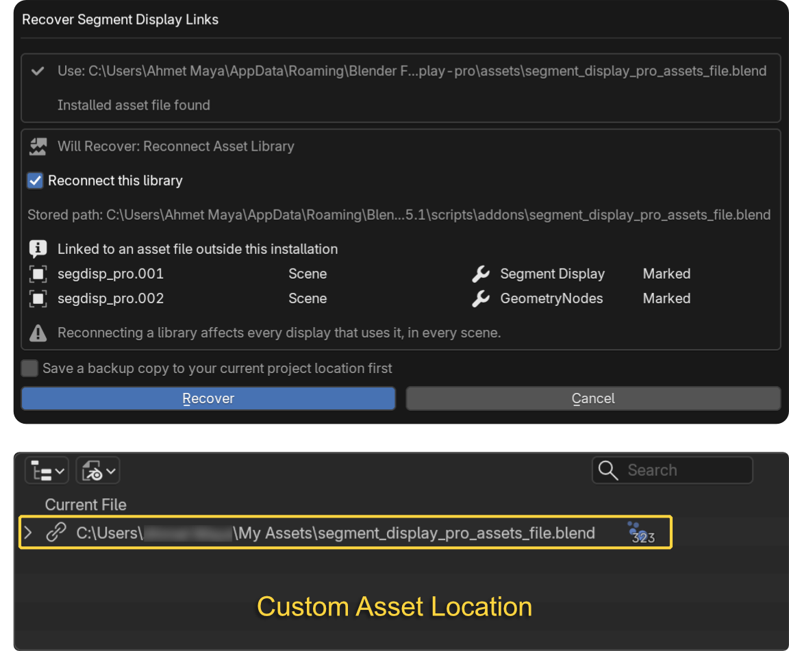

**Reconnecting a library affects every display using it, in every scene.** When the original modifiers and stored settings/animation remain intact, reconnecting restores the displays using that retained data.

Blender may temporarily stop responding while relocating and reloading linked asset data, particularly for paths outside the current installation. Allow it to finish; a temporary not-responding message does not necessarily mean Blender has crashed. Duration varies.

#### Other results

- **Will Fix: Toggle Inputs:** Repairs supported Boolean inputs stored as numbers while preserving their on/off values.
- **Not Changed:** Reports unsupported or excluded items, such as other-edition objects, local asset-tree copies, unknown asset sources, non-editable or source-linked objects, and missing modifiers that do not qualify for recreation. Recovery does not directly edit source-linked modifiers; repair and save the owning project instead.

Only sections relevant to your project appear. Recovery can be unavailable if the license is inactive, the installed asset is missing or there is nothing supported to recover.

#### Backup, recover and save

1. Review the selected actions. Leave uncertain entries unchecked.
2. Keep **Save a backup copy to your current project location first** enabled when possible. A backup requires a project already saved to disk; an unsaved project shows **File not saved yet, no backup copy possible**. Save it first if you want a backup.
3. Click **Recover**. If a requested backup fails, recovery cancels without making changes.
4. Read the result, including skipped/failed repairs or settings that could not be restored. Inspect the displays, settings and animation.
5. **Save your project** to retain successful repairs. Creating a backup does not save the repaired project automatically.

#### Asset Not Available

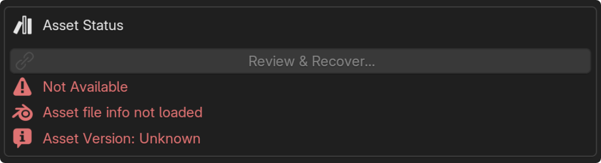

If your displays appear as planes and you see these messages, **do not panic or try to fix the Modifiers panel**. The installed asset may be missing, damaged or outside the expected add-on `assets` location. This does not by itself mean your stored display settings are lost.

1. Preserve a project copy and leave existing modifiers, node-tree assignments and recognition properties untouched.
2. Reinstall the complete matching Pro ZIP with the shipped asset included, then restart Blender and reopen the project.
3. Check the displays first. Reinstalling and restarting is often sufficient; if they are restored correctly, no recovery operation is needed.
4. If supported connection problems remain, use **Review & Recover…** once the installed asset is available. Inspect the result and save.

The recovery button can remain disabled until the installed asset is available. Reconnection preserves data still present; it cannot restore deleted settings or animation. See [Troubleshooting](troubleshooting.md#the-asset-file) for related issues.

### Linked Asset

You can inspect the linked library in **Outliner > Blender File**. Do not remove it as a cleanup or recovery shortcut. Do not open, modify, re-save, rename or move the shipped asset file; reinstall the original ZIP if it was altered.

## Resources & Support

The **Resources & Support** box in the add-on preferences collects quick links to help and account pages. Each link opens in your web browser unless noted otherwise.

- **Documentation Home:** Opens this manual.
- **Activation/Deactivation:** Opens the [activation steps](installation.md#activationdeactivation).
- **Get Started:** Opens the [Introduction](introduction.md).
- **User Guide:** Opens the Input Categories pages, starting with [Numbers](in_cat_numbers.md).
- **Troubleshooting:** Opens the [Troubleshooting](troubleshooting.md) page.
- **Orion November Studio:** Opens the studio website.
- **SegDisp Pro Overview Video:** Opens the add-on overview video on YouTube.
- **Email Support:** :material-tag-outline: **Pro v1.0.1 and later.** Opens your default email app with a new message to **support@orionnovemberstudio.com**. If nothing opens, your computer has no default email app set up; send your message to that address from any email account.
- **Manage My Orders:** Opens your Lemon Squeezy order dashboard, where you can find your license key and manage your activations.

!!! info "Contacting support"
    Include your Blender version, operating system and add-on version (shown in [About](#about-panel)) so we can help you faster.

## About Panel

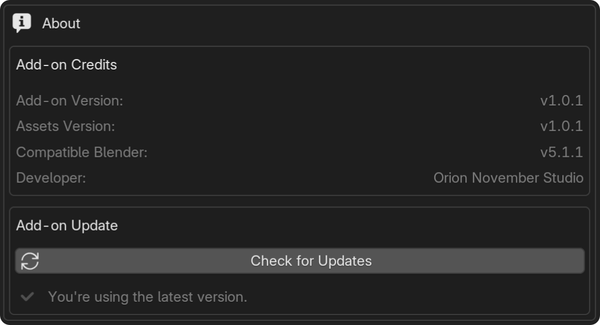

:material-tag-outline: **v1.0.1 and later**

About shows your installed product information and update-check results. Open **Edit > Preferences > Add-ons > Segment Display Pro > About**, or expand **About** at the bottom of the **SegDisp Pro** N-panel. The N-panel section starts collapsed; the Preferences section is not collapsible. If the N-panel hides About while an unrelated object is selected, deselect it or use Preferences.

### Add-on Credits

The v1.0.1 interface labels this group **Add-on Credits**.

- **Add-on Version:** The version of the code currently running in Blender.
- **Assets Version:** The version reported by the installed asset file. **Unknown** means its version information is unavailable, not that the asset is current.
- **Compatible Blender:** The add-on's declared minimum Blender version, not a list of every tested or recommended version. See [Requirements](installation.md#requirements).
- **Developer:** The product's developer credit.

**The add-on and asset versions must match.** If you see **Doesn’t match add-on version** or **Restart Blender to finish updating to…**, restart Blender first: replacing installed files does not immediately replace code already loaded in memory. If a mismatch remains after restarting, reinstall the complete matching Pro ZIP. Do not mix script and asset files from different versions or editions. A known mismatch can block adding a display; **Unknown** is not confirmation that the versions match.

### Add-on Update

Click **Check for Updates** to request a check. The add-on also checks automatically at startup; opening About does not itself start another check.

- **Checking… / Checking for updates...:** A request is running. Wait for it to finish; repeat checks are disabled while it runs.
- **You're using the latest version.:** The check found no newer release.
- **Update available: v…:** A newer release was found. Check for Updates is disabled while a confirmed downloadable update is already available; use **Open Downloads** instead.
- **Couldn't check for updates. Try again.:** The request failed. Check your connection and Blender online-access permission, then retry. A previous successful result may remain visible as **Previous result**; it is not a fresh check.

**Open Downloads** opens the release download page in your browser; it does not download or install the add-on or restart Blender. An activated license is required to use this button. If a **Before you update** dialog appears, read its release notice before continuing. Install the downloaded ZIP yourself and restart Blender. See [Updating the Add-on](installation.md#updating-the-add-on).

Update checks require internet access and **Preferences > System > Network > Allow Online Access**. If Blender was launched with `--offline-mode`, restart without that flag before checking again.

### N-panel update notifications

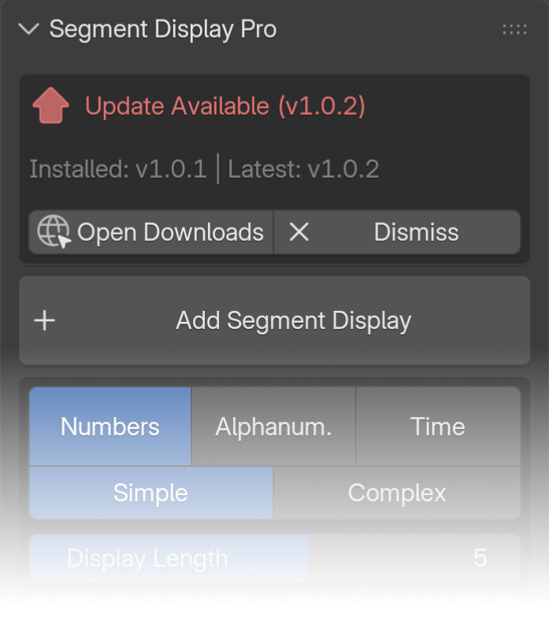{ align=right width="350" }

An automatic check can show **Update Available** at the top of the N-panel. **Dismiss** asks whether to hide these header notices. You can change the same preference under **Edit > Preferences > Add-ons > Segment Display Pro > N-panel Options > Hide "Update Available" Notifications on the N-Panel Header**.

This hides only the N-panel header update notice. Update information remains available in About and Preferences; license and asset-status warnings are not hidden.

The notification preference is saved in `addon_userpref.json` beside the activation file, outside the installed add-on folder, so it can survive normal updates and reinstalls. **In v1.0.1, this file stores only the header update-notice preference, not all add-on preferences or per-object display settings.** Change it through Blender rather than editing the file manually. See [The License File](installation.md#the-license-file) for the Pro storage directory; the preference file is separate from the activation file and does not activate the add-on.

## Addon N-panel Settings {: .clear }
### Time Synchronization

Time Synchronization syncs the Clock and Timer display values to Blender's timeline, matching the add-on's FPS with the scene FPS so the displayed time updates accurately as the animation plays.
Set the FPS using the Addon Frame Rate dropdown menu in Addon Settings to match your project's frame rate.

The Animation Start Offset option, available in both Clock and Timer, calculates its timing based on the scene FPS and the add-on's internal FPS. See the [Input Categories/ Time Page](in_cat_time.md#general-overview) for more details.

!!! info
     This option only works correctly with whole-number frame rates (e.g., 24, 25, 30, 60). Decimal frame rates such as 23.98 or 29.97 will produce slightly inaccurate results due to mathematical limitations.

<figure markdown>
  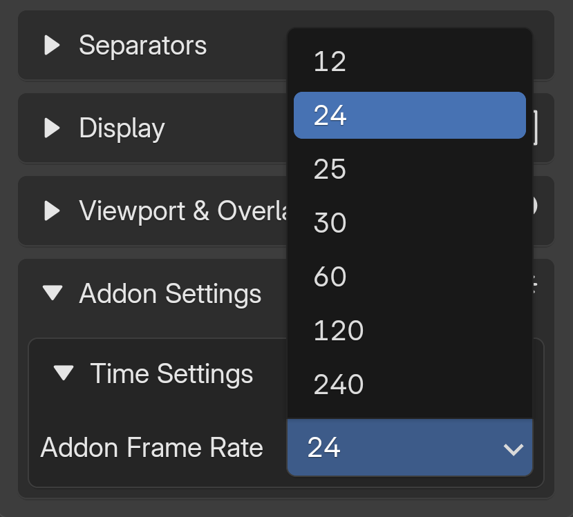{ width="400" }
  <figcaption>Addon FPS</figcaption>
</figure>

<figure markdown>
  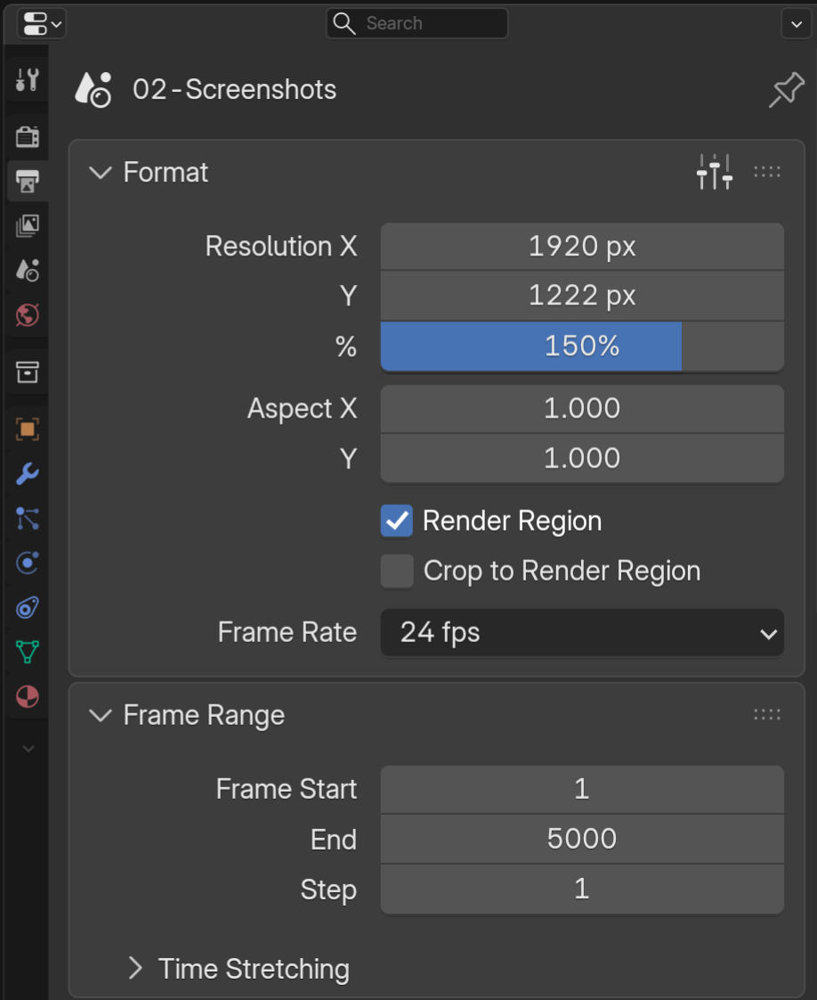{ width="400" }
  <figcaption>Scene FPS</figcaption>
</figure>

