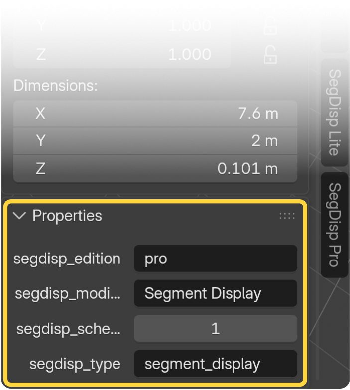
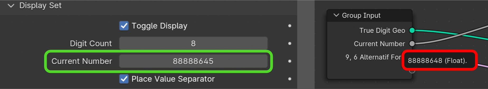
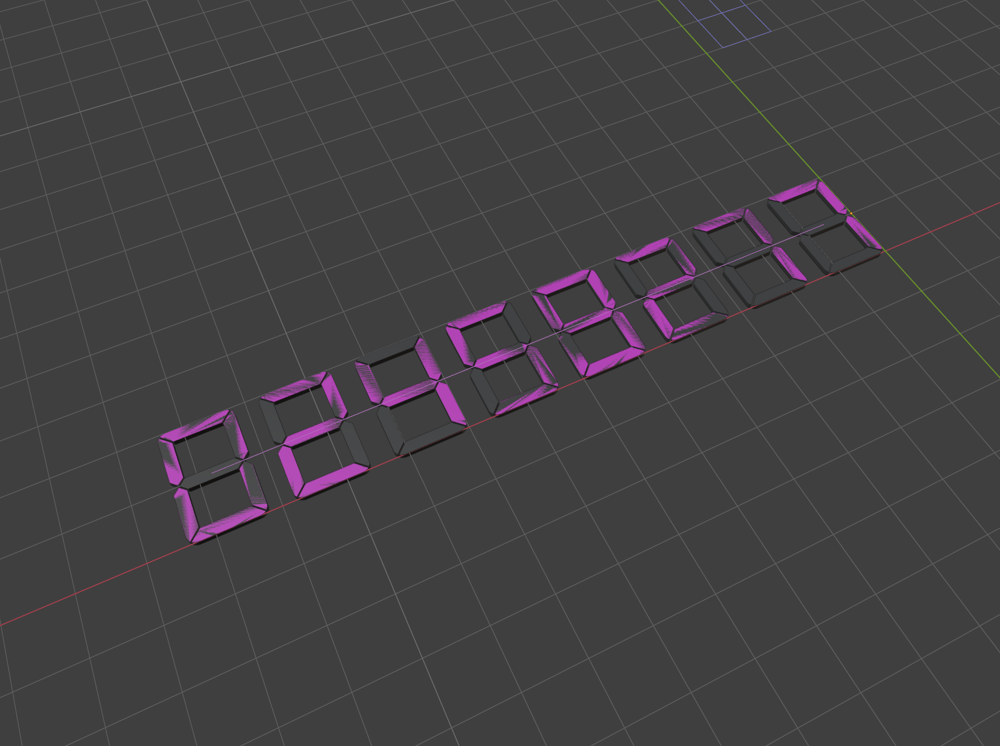
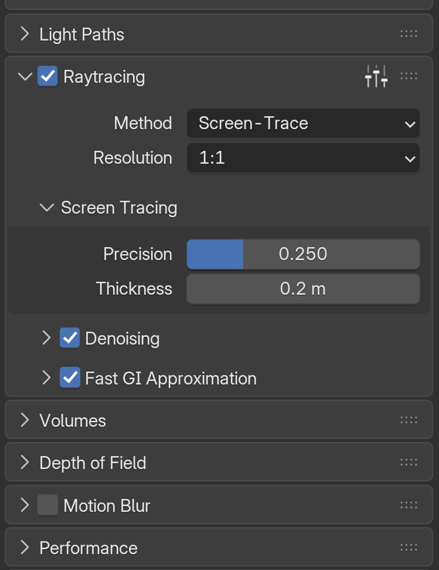

## The Asset File

Displays use the .blend asset linked from the add-on's `assets` folder. Multiple displays, including those in other scenes, can share the same library. Do not delete that library from **Outliner > Blender File** as a repair or cleanup shortcut. Only purge unused data after you no longer need the displays and their dependencies.

:material-tag-outline: **Pro v1.0.1 and later**

### Displays appear as planes / Asset Not Available

**Do not panic or edit the Modifiers panel.** Planes after launch, together with **Not Available**, **Asset file info not loaded** and **Asset Version: Unknown**, can mean the installed asset is missing, damaged or outside its expected location. The messages do not by themselves mean your stored settings are lost.

1. Preserve a project copy; leave modifiers, node-tree assignments and recognition properties untouched.
2. Reinstall the complete matching Pro ZIP and restart Blender.
3. Reopen and inspect the project. Displays often return automatically; if they are correct, no recovery operation is needed.
4. If supported connection issues remain, use **Preferences > Add-ons > Segment Display Pro > Asset Status > Review & Recover…** once the installed asset is available. Review repairs, inspect the result and save.

The recovery button may be disabled while the installed asset is unavailable. **Available** only confirms the installed asset can be found, not that every project connection is healthy. For **Unknown** version information or known asset/add-on version mismatches, restart after updating first; if the issue persists, reinstall the complete matching package. A known mismatch can block **Add Segment Display**. Do not mix asset/script versions, edit the asset or change licensing to bypass the check.

In About, these cases appear as **Doesn’t match add-on version** next to Assets Version, or **Restart Blender to finish updating to…** after installing an update while Blender is running. See [Add-on Credits](prefs_and_settings.md#add-on-credits).

### Recovery limits and lost settings

Reconnecting a library restores displays using settings and animation still present. **Restore Node Tree** assigns the tree to an existing supported modifier; it cannot restore settings or animation already deleted by removing the assignment in the Geometry Nodes panel. Removing the asset through **Outliner > Blender File** can leave recoverable settings, but is not a recommended repair method.

**Recreate Missing Modifier (Defaults)** is opt-in and adds a new modifier at the end of the stack. It does not restore deleted settings, animation or the original stack position. In v1.0.1, the deleted-settings warning is not yet shown under Restore Node Tree; its absence does not guarantee recovery. See the [full walkthrough](prefs_and_settings.md#review-recover).

### Blender temporarily stops responding

Blender may pause while recovery relocates and reloads an asset library pointing outside the current installation. Allow it to finish; a temporary not-responding message does not necessarily mean a crash. Duration varies. This operation involves Blender's library handling, not solely add-on processing; its precise bottleneck and whether pauses are limited to relocation have not been established.

### Asset safety

!!! warning "Do not open or modify the asset file!"
    Do not open, modify, re-save, rename or move the shipped .blend asset. Re-saving changes its byte-level fingerprint even if it looks unchanged. Reinstall the original complete ZIP if the file was altered. This is asset-safety guidance, not a claim that installed files are read-only or that an in-add-on runtime hash check protects them.

    **Why this matters for support:** OrionNovember.Studio cannot provide support for modified asset files. Opening and re-saving the shipped asset changes its digital fingerprint, even if you make no visible changes. If the asset has been modified, reinstall the complete add-on from the original ZIP before requesting support.

**Lite users:** Lite recovery differs and is not covered in this Pro manual.

---

## The Segment Display Object

The "Add Segment Display" button in the N-panel interface only appears when you click on an empty space in the 3D scene. The object is always added at the current 3D cursor location.

The N-panel always displays the settings of the active segment display object (the one with the brighter outline, i.e. the last one you clicked). You don't need it to be the only selected object; even if multiple objects are selected, the panel controls whichever segment display is active.

The object settings will only appear if a Segment Display object is active or selected. If any other type of element is selected in the scene, a "Select a Segment Display object" message will be shown instead.

!!! info "Important"
    Each edition can only control objects created with that edition. SegDisp Pro cannot control SegDisp Lite objects, and SegDisp Lite cannot control SegDisp Pro objects. Use the matching add-on's N-panel to adjust each object.

### Pro recognition properties and modifiers


{ align=right width="350" }


Local Pro objects can contain `segdisp_type`, `segdisp_schema`, `segdisp_edition` and `segdisp_modifier`. These are recognition/recovery metadata, not display inputs or the asset file's fingerprint. **Do not change/delete them or manually rename/delete the display modifier.**

**Where to review these IDs:** Select the SegDisp Pro object in the 3D Viewport, press **N** to open the sidebar, then open **Item > Properties** to inspect its `segdisp_*` custom properties. Review them without changing or deleting their values.

**Why these IDs matter:** Review & Recover uses these properties to recognize a SegDisp Pro object and help determine which repairs are safe, especially when its asset-tree assignment or modifier is missing. `segdisp_type` and `segdisp_edition` identify the object as a Pro display, `segdisp_schema` records the recognition-data format, and `segdisp_modifier` remembers the display modifier's name. Changing or deleting them can prevent confident identification, send an object to **Needs Review**, or make supported recovery unavailable. They do not store a backup of your input settings or animation, so keeping them intact does not restore data that has already been deleted.

An object can be recognized while its empty modifier remains ambiguous. Names such as **GeometryNodes** are not proof of a SegDisp modifier. If the remembered modifier name no longer matches, select the correct target only if you recognize it in **Needs Review**; otherwise leave it unchecked. An exact remembered match can still identify a generically named modifier. See [Needs Review](prefs_and_settings.md#needs-review).

### Linking displays from another project {: .clear }

Linking SegDisp objects from another project is not currently a validated workflow. Configure and animate displays in their owning project. Changes saved there do not live-update an already open destination; reload the source library after repairing and saving the source.

Lite testing showed modifier input-type errors after a source-library reload (**Property type does not match input socket**, for example on Show Separator Origin Point). Restarting Blender cleared the observed error, but is not a guaranteed fix or a confirmed Pro defect. Neither still nor animated rendering through this nested-link workflow has been validated. Recovery does not directly edit source-linked modifiers, although reconnecting a shared asset library can affect linked displays visually.

---

## Licensing

Activation limits per license key: **Pro: 3 activation seats; Lite: 1 activation seat.**

Segment Display Pro is a commercial add-on. It uses license-key activation, so a
valid key is required to unlock the full feature set. See the [Activation Page](installation.md#activationdeactivation) for details.

## License Deactivation Before Uninstall
!!! warning "Always deactivate your license before uninstalling the add-on."
     If you remove the add-on without deactivating first, the device will still count toward your activation limit. Unfortunately, Blender's API does not allow add-ons to prevent or intercept the uninstall action, so the add-on cannot warn you or auto-deactivate at that point. If you accidentally uninstall without deactivating, you can free up the slot yourself from your <a href="https://app.lemonsqueezy.com/my-orders" target="_blank" rel="noopener">Lemon Squeezy order dashboard</a>. If you need help with this, please contact us via our support email.

!!! internet "License activation and deactivation both require an internet connection."
     Activation validates your license key online, and deactivation contacts the server to free up your activation slot. This ensures your activation count stays accurate and protected. If either fails, make sure "Allow Online Access" is enabled in Blender under Preferences > System > Network.

## License Locked Messages

When the add-on is locked, a red message appears at the top of the N-panel and in the license panel in Preferences, with **Read more...** and **Verify now** buttons below it. The Status line shows "Not Activated". None of these use a new activation seat.

| Message | What it means | What to do |
| ------- | ------------- | ---------- |
| Offline period expired | The license couldn't be checked online for 14 days. | Go online, make sure "Allow Online Access" is enabled, and click **Verify now**. The add-on also unlocks on its own within about 2 minutes, or after a Blender restart. |
| System clock was moved back | Your computer's clock is earlier than the last license check or the last time the add-on was used. | Correct your system date and time, go online, then click **Verify now**. |
| License not verified online | The license couldn't be confirmed online. | Go online, make sure "Allow Online Access" is enabled, and click **Verify now**. |
| Activation belongs to another computer (Status line) | The activation was copied from a different computer. | Activate with your license key on this computer. Each computer needs its own activation. |

### Verify now results

After you click **Verify now**, the add-on checks your license online and shows one of these popups:

| Popup | What it means |
| ----- | ------------- |
| License Verified | Your license was confirmed online. The add-on is active again and the 14-day offline period starts over. |
| No Internet Connection | The license server couldn't be reached. Check your internet connection and make sure "Allow Online Access" is enabled in Preferences > System > Network, then try again. |
| Verification Failed | The server rejected the activation (for example, the device was removed from your Lemon Squeezy order dashboard) or didn't answer in time. Try again, or activate again with your license key. |

---

## Numbers

Blender uses single-precision floating point (float32) internally. Because of this, the Segment Display add-on cannot produce correct digit results beyond 7 digits, even when using whole integers. If you enter a number with more than 7 digits, expect rounding errors or incorrect segment values.

{ width="1000" }

To work around this, the add-on provides a Complex Number Input option. Instead of typing a large number into a single input field (which Blender would corrupt beyond 7 digits), you enter values into manageable three-digit blocks (0–999) categorized by their place value. This allows the display to safely represent numbers up to the hundred trillions (15 digits) without precision loss. See the [Numbers Page](in_cat_numbers.md) for details.

---

## Alphanumeric Preset Animations (Multi-Input)

**Bypassing Blender's Limits:** Because Blender does not natively support the animation of string (text) inputs, the add-on includes a built-in multi-input preset system. See the [Alphanumeric Input Page](in_cat_alphanum.md) for details.

---

## Time FPS

The auto time animations (Clock, Timer) and the Animation Start Offset feature only work correctly with whole-number frame rates (e.g. 24, 25, 30, 60). Decimal frame rates such as 23.98 or 29.97 will produce slightly inaccurate timing results due to mathematical limitations in how Blender calculates frame-to-time conversions.

Make sure the Addon Frame Rate dropdown in the add-on's N-panel settings matches your project's scene frame rate for accurate time synchronization. For more information, see the [Settings Page](prefs_and_settings.md#time-synchronization).

---

## Viewport | Solid Color Preview

{ align=right width="500" }


The Solid Viewport Preview feature may not display correctly in certain conditions:
With some of the Matcap lighting methods in the 3D Viewport's solid shading mode.
If Snap Guides are enabled (this is handled internally with a state toggle).

If your Segment Display object looks glitchy from a distance when Solid Viewport Preview is enabled, increase the Clip Start value (near clipping distance) in the Blender N-Panel View options. The add-on also makes a slight adjustment to the LED Base to prevent this geometry face clipping issue. The temporary LED Base adjustment applies exclusively to the Solid Viewport Preview and will not appear in still image or animation renders.

For more details on this feature, see the  [Viewport & Overlays page](viewport_overlays.md#viewport-solid-preview)

---

## EEVEE Render Engine Tips

To allow the Segment Display emission to interact with the scene in EEVEE — similar to the Cycles engine — enable the Raytracing option in Properties > Render Properties.

{width="400"}

---

## Blender Terminal Issues
### "VFont -> Node" Warnings

When using the Segment Display add-on, you may occasionally see the following messages in the Blender System Console:

```
Failed to add relation "VFont -> Node"
Could not find op_from: ComponentKey(VFBfont Regular, GENERIC_DATABLOCK)
```

These are technical warnings from Blender's Dependency Graph (Depsgraph). They occur when Blender attempts to rebuild the internal connection map between objects and fonts while a script or asset is being reloaded. Because the add-on uses complex, nested Geometry Node groups to generate dynamic text, Blender sometimes tries to link the Font datablock to the node tree before the font has been fully registered.

This is most common when:

- Reloading scripts using F8 or the "Reload Scripts" operator while the add-on is active.
- Reverting or restarting the current Blender project file.
Linking or re-importing the display asset from a library.

**Should you be worried?** No. These messages are non-fatal, purely cosmetic, and do not affect your final output. The fonts referenced in these warnings are only used during the development stage for math, time, and numbering debug purposes. The Segment Display add-on is built entirely using custom meshes and curves, not fonts; it does not rely on these system fonts for the final generated geometry or rendering. Blender's dependency graph recovers automatically once the reload is complete.

To resolve: Simply save and restart Blender, or open a fresh file. Since the add-on's functionality is not affected, you can safely ignore these messages during your workflow.

<a href="https://projects.blender.org/blender/blender/issues/154517" target="_blank" rel="noopener">See the current issue on Blender Developer</a>


